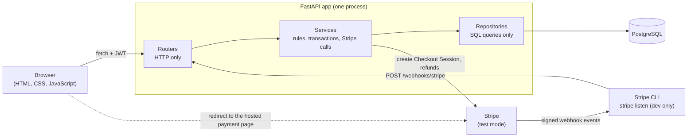
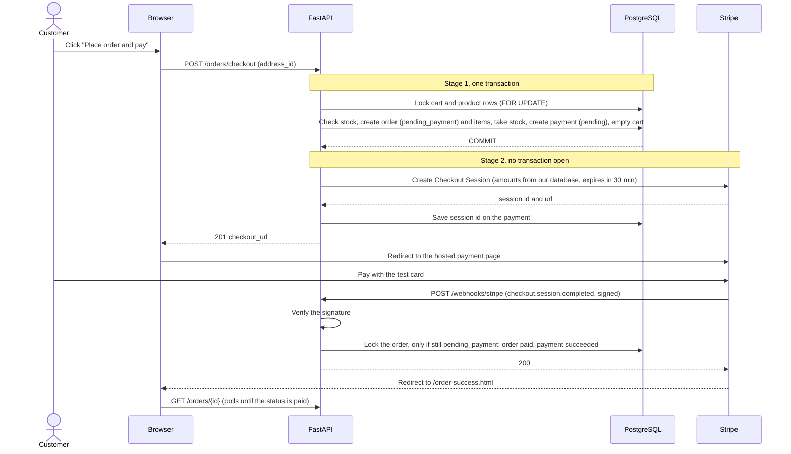
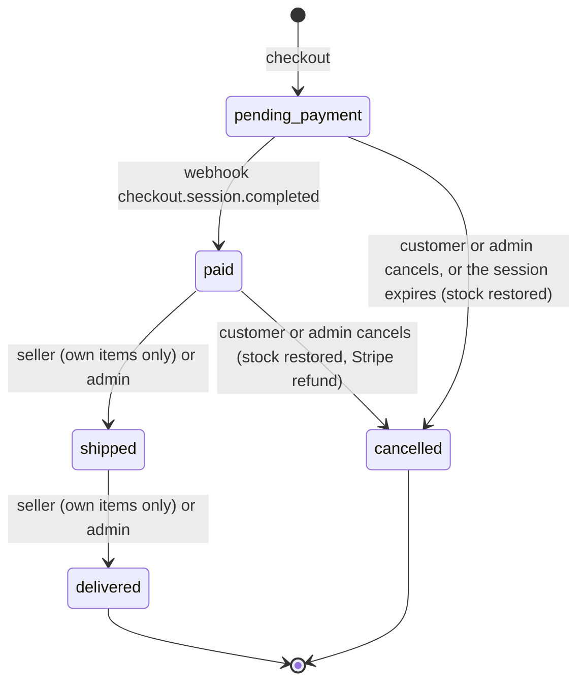

# ShopEasy: an Amazon-style store, built for learning

ShopEasy is a small but complete online shop. Customers browse, search, fill a cart, pay with Stripe (test mode only) and follow their orders. Sellers manage their products and ship orders. Admins see everything.

It is a **well-built monolith**: one FastAPI app that serves the API and the web pages, and one PostgreSQL database. The goal is to understand the whole web development flow, from the browser to the database, including transactions, authorization, payment webhooks and order lifecycles. There is no React, no Redis and no queue on purpose. Shipping is mocked, and no real money is ever used.

## What you can do

**Customer**
- Browse categories, search products (full-text search), filter by price and stock, sort, and page through results
- Keep a cart, manage delivery addresses, and check out
- Pay on Stripe's hosted page with a test card, and watch the order become "Paid" when Stripe confirms
- See order history and order details, and cancel an order (an unpaid order is released, a paid one is refunded)

**Seller**
- Create, edit, deactivate and re-activate their own products (price, stock, image, category)
- See the paid orders that contain their products (only their own lines, never the customer's email)
- Mark an order as shipped and then delivered, when every item in it is theirs

**Admin**
- See all orders and all users
- Move any order to shipped or delivered, cancel any order (with a refund when it was paid)
- Create, rename and delete categories

## Tech stack

| Part | Choice |
|---|---|
| Backend | Python 3.12, FastAPI, Pydantic |
| Database | PostgreSQL 16 |
| ORM and migrations | SQLAlchemy 2.x (synchronous), Alembic |
| Login | JWT access token (PyJWT, HS256), passwords hashed with bcrypt |
| Payments | Stripe Checkout (hosted page) and Stripe webhooks, **test mode only** |
| Frontend | Plain HTML, CSS and JavaScript (`fetch`), served by FastAPI. No framework, no build step |
| Tests | pytest and httpx against a real PostgreSQL test database |
| Dev environment | Docker Compose (`app` and `db`). The Stripe CLI runs on your computer and forwards webhooks |

## Architecture

The code has three layers and each one has one job. Routers speak HTTP. Services hold the business rules and own the database transaction (and the Stripe calls). Repositories only run database queries.



Checkout has two stages, because a database transaction must never stay open during a network call. Stock is reserved in a transaction first, and only then is Stripe called. Stripe confirms the payment later, with a signed webhook. Only the webhook marks an order as paid, never the success page.





Every other change is rejected with 409.

## Quick start

You need: **Docker** (with Docker Compose), a **Stripe account in test mode** (a free account is enough) and the **Stripe CLI**.

1. Clone the project and go into it:

   ```bash
   git clone https://github.com/pushpendra-paswan/ecom.git
   cd ecom
   ```

2. Copy the example settings:

   ```bash
   cp .env.example .env
   ```

3. Make a secret for the login tokens:

   ```bash
   openssl rand -hex 32
   ```

   Open `.env` and replace `REPLACE_ME` after `JWT_SECRET=` with the output. The app refuses to start when the secret is missing or shorter than 32 characters.

4. In the Stripe dashboard (test mode) copy your **secret key** (it starts with `sk_test_`) into `.env` as `STRIPE_SECRET_KEY=`. Only test keys are accepted.

5. Build and start the app and the database:

   ```bash
   docker compose up --build
   ```

   Leave this running and open a second terminal for the next steps. (Or add `-d` to run it in the background.)

6. Create the tables:

   ```bash
   docker compose exec app alembic upgrade head
   ```

7. Fill the database with demo data (5 accounts, 10 categories, 120 products):

   ```bash
   docker compose exec app python -m app.seed
   ```

8. Open the site at <http://localhost:8000/>.

9. In a third terminal, on your computer (not inside Docker), forward Stripe's webhooks to the app. The CLI needs to know your Stripe account: either run `stripe login` once, or put your test key in the environment (`export STRIPE_API_KEY=sk_test_...`). Then:

   ```bash
   stripe listen --events checkout.session.completed,checkout.session.expired --forward-to localhost:8000/webhooks/stripe
   ```

   It prints `Your webhook signing secret is whsec_...`. Leave it running.

10. Copy that `whsec_...` value into `.env` as `STRIPE_WEBHOOK_SECRET=`, then recreate the app container so it reads the new value:

    ```bash
    docker compose up -d --force-recreate app
    ```

11. Log in as `customer1@example.com`, add something to the cart and check out. On Stripe's page pay with the test card `4242 4242 4242 4242`, any future expiry date and any CVC. You land on the success page, which says "Payment received" once the webhook has arrived.

Other test cards (for example a declined one) are listed at <https://docs.stripe.com/testing>.

## Accounts and useful URLs

Every seeded account has the dev password `Password@123`.

| Email | Role |
|---|---|
| `admin@example.com` | admin |
| `seller1@example.com` | seller |
| `seller2@example.com` | seller |
| `customer1@example.com` | customer (has an address in Bengaluru) |
| `customer2@example.com` | customer (has an address in Mumbai) |

| URL | What |
|---|---|
| <http://localhost:8000/> | the store |
| <http://localhost:8000/docs> | interactive API documentation (Swagger UI) |
| <http://localhost:8000/health> | health check (also checks the database) |

The Postgres port is **not** published to your computer, so it cannot clash with a local Postgres. To look inside the database use `docker compose exec db psql -U postgres ecommerce`.

## Running the tests

The tests run against a real PostgreSQL database named `ecommerce_test`, which is created automatically. They never call the real Stripe API: every Stripe call is patched, and webhooks are tested with events signed by a test secret.

```bash
docker compose exec app pytest
```

With a coverage report (the lines that were not run are listed per file):

```bash
docker compose exec app pytest --cov=app --cov-report=term-missing
```

The concurrency tests (two buyers for the last item, a webhook delivered twice, a cancel racing a shipment) are the ones most likely to expose a locking mistake, so it is worth repeating them. This runs them 20 times and stops at the first failure:

```bash
for run in $(seq 1 20); do docker compose exec -T app pytest -q tests/test_checkout_concurrency.py tests/test_webhooks_concurrency.py tests/test_order_lifecycle_concurrency.py || break; done
```

`tests/test_endpoint_security.py` lists every endpoint with its access rule. Adding an endpoint without adding it to that list makes the test fail, so every new endpoint needs a decision about who may call it.

### Running without auto-reload

The development setup starts uvicorn with `--reload`, so it restarts when you edit a file. To run the app the way a server would, without it, stop the stack and start only the app with a different command (the database starts with it):

```bash
docker compose down
docker compose run --rm --service-ports app uvicorn app.main:app --host 0.0.0.0 --port 8000
```

Give it a few seconds: the app waits for the database to be healthy before it starts. There is no "Will watch for changes" line in its log, and a code change no longer restarts it.

## Project structure

```
app/
  main.py            the app, security headers, error handlers, /health, static and page mounts
  db.py              engine (15 second statement timeout), session, get_db
  core/              config.py (settings), dependencies.py (get_current_user, require_customer/seller/admin)
  routers/           HTTP only: auth, users, admin, categories, products, cart, orders, seller_orders, webhooks
  services/          rules and transactions, and the Stripe calls
  repositories/      SQL queries only
  models/            SQLAlchemy models (9 tables)
  schemas/           Pydantic request and response models (with input limits)
  seed.py            demo data: python -m app.seed
alembic/             database migrations
frontend/            HTML pages
static/              css, js (one file per page, plus api.js and layout.js) and images
tests/               pytest tests
CLAUDE.md            the rules for this code base (coding style, architecture, payment rules)
PROJECT_CONTEXT.md   the detailed notes: schema, endpoints, design decisions, performance and security
```

**How to read the code.** Pick one request and follow it down the layers. For example `POST /orders/checkout`:
1. `app/routers/orders.py` parses the request and calls the service.
2. `app/services/checkout_service.py` is where the story is: lock the rows, check the stock, create the order, call Stripe, handle failure. It is written as plain steps from top to bottom with a comment above each.
3. `app/repositories/order_repository.py` (and the cart and product repositories) hold the SQL it uses.

Then read `app/services/webhook_service.py` to see how the payment comes back. `CLAUDE.md` explains the coding style (simple, sequential, no clever abstractions) and `PROJECT_CONTEXT.md` records every decision and the database schema.

## Key design decisions

- **Money is an integer in paise** (the smallest unit), never a float. It is the same number Stripe expects. A price is at most 10,000,000 paise (₹1,00,000) and an order at most 99,999,999 paise (Stripe's limit of eight digits).
- **Snapshots.** An order stores the product name and unit price of every line, and a copy of the shipping address. Later edits to a product or an address never rewrite order history.
- **Row locking and lock order.** Checkout locks the user's cart row and then the product rows (`SELECT ... FOR UPDATE`) in ascending id order, so two buyers can never both take the last item and two checkouts can never deadlock. Everything that changes an order locks the order row first and reads its status inside the lock.
- **Two-stage checkout.** Reserve stock in one short transaction, then call Stripe outside any transaction. If Stripe fails, the order is cancelled and the stock and cart are restored in one transaction.
- **Signed, idempotent webhooks.** The Stripe signature is checked on the exact raw bytes. Stripe retries and sends duplicates, so the order is only changed if it is still `pending_payment`, decided inside the row lock. A late payment for an order that was already cancelled is refunded automatically.
- **Cancel flow with refunds.** The database change is committed first, then Stripe is called. If the refund call fails, the order stays cancelled (stock is back) and the customer or an admin can press "Retry refund". The idempotency key makes the retry safe.
- **Soft delete of products.** Deleting a product only sets `is_active = false`, so old orders and carts that point to it stay valid.
- **No Redis, no queues.** The cart lives in Postgres. The webhook is a normal request handler. Caching and background jobs are out of scope on purpose.
- **Same origin.** The pages and the API are served by the same app, so there is no CORS configuration at all.

## Security notes

What is protected:
- Passwords are hashed with bcrypt. Login takes the same time and gives the same message for an unknown email and a wrong password (a dummy hash is checked for unknown emails).
- Tokens are checked with HS256 only, with `exp` and `sub` required. The user's role and active flag always come from the database, never from the token. The app refuses to start with a `JWT_SECRET` shorter than 32 characters.
- Every endpoint has a deliberate access rule (customer, seller, admin, or public) that a test checks. Other people's carts, orders, addresses and products look like "not found" (404).
- No response contains a password hash, a Stripe id, a token or a secret (a test checks every GET endpoint). Only admin pages and "my own data" show an email.
- Security headers on every response (`X-Content-Type-Options`, `X-Frame-Options`, `Referrer-Policy`, `Permissions-Policy`) and a strict Content-Security-Policy (`script-src 'self'`, `style-src 'self'`, no inline script or style) on everything except the API docs, which load their scripts from a CDN.
- The frontend never uses `innerHTML` with data from the API (only `textContent`), and the checkout only redirects to `https://checkout.stripe.com/`.
- Every string and number the API accepts has a limit that fits its database column. Odd input (huge numbers, NUL characters, very long text) gives a clean 4xx, never a 500. A request body over 1,000,000 bytes is refused (413).
- An unexpected error returns `500 {"detail": "Internal server error"}`. The details go to the log only. Passwords, tokens, request bodies and Stripe keys are never logged.
- Card details never touch this server: they are typed on Stripe's page.
- Postgres statements time out after 15 seconds.

Accepted gaps (not built, on purpose):
- **No login rate limiting.** Anyone can try passwords as fast as the server answers. The next step would be a Postgres-based throttle or a reverse proxy.
- **No token revocation and no refresh tokens.** A token lives for `JWT_EXPIRE_MINUTES` (60 by default). A disabled account is refused at once (the user is loaded from the database on every request), but a stolen token of an active account works until it expires.
- **Registration reveals whether an email exists** (it answers 409 for a taken email).
- **The token lives in `localStorage`**, so a cross-site scripting bug could read it. The mitigations are the Content-Security-Policy, rendering with `textContent` only, and the short token life. httpOnly cookies would need CSRF protection and are out of scope. CSRF does not apply to the API as it is, because it uses a bearer header and not cookies.
- **No HSTS header.** `Strict-Transport-Security` belongs behind HTTPS, so add it (or let the reverse proxy add it) when you deploy with HTTPS. Never serve the app over plain HTTP in production.
- The body size limit looks at the `Content-Length` header, so a chunked upload without that header is not covered by it.

## Known limitations and future work

- **Reviews and ratings** are deferred on purpose (no tables, endpoints or pages yet). `PROJECT_CONTEXT.md` has a sketch of what they need.
- Login rate limiting, token revocation and refresh tokens (see above)
- Email notifications (nothing is sent)
- Returns and partial refunds (only full refunds, and no returns after delivery)
- Per-item fulfilment (one order has one status, so a seller can only ship an order made only of their products)
- Other payment methods (only cards; asynchronous payment methods are not handled)
- A very small order total can be rejected by Stripe, which has a minimum charge amount (the order is then cancelled and the cart restored)
- Deployment: HTTPS, a production server setup, secrets management, backups and monitoring

## Troubleshooting

- **`stripe listen` shows 400 answers, or orders never get paid.** The signing secret in `.env` does not match the one `stripe listen` printed. Copy the current `whsec_...` value into `STRIPE_WEBHOOK_SECRET` and run `docker compose up -d --force-recreate app`. A new `stripe listen` session can print a different secret.
- **An order stays "Awaiting payment" after paying.** `stripe listen` is not running (or not forwarding to `localhost:8000/webhooks/stripe`). Start it, then send the missed event again with `stripe events resend <event id>` (the event id is in the Stripe dashboard under Developers, Events).
- **Port 8000 (or 5432) is already in use.** Stop whatever uses it, or change the left number of `"8000:8000"` in `docker-compose.yml`. Postgres is not published to your computer by default; if you add a `ports:` entry for it and 5432 is taken, use another host port such as `"5433:5432"`.
- **Checkout says "Payment service is unavailable. Your cart has not been changed."** Stripe could not create the payment page. The usual causes are a wrong or expired `STRIPE_SECRET_KEY`, no internet connection, or an order number that Stripe has seen before: checkout uses `order-<id>` as the idempotency key and Stripe remembers a key for 24 hours, so after a database reset (order numbers start at 1 again) the first order can clash with an old one from the same Stripe account. Nothing is lost (the order is cancelled and the cart is put back). Move the order counter forward and try again:

  ```bash
  docker compose exec db psql -U postgres ecommerce -c "SELECT setval('orders_id_seq', 7000)"
  ```
- **Start again from an empty database.** This deletes all data (including the test database):

  ```bash
  docker compose down -v
  docker compose up -d --build
  docker compose exec app alembic upgrade head
  docker compose exec app python -m app.seed
  ```

  After a reset the order numbers start at 1 again (see the previous item if the first checkout fails).
- **`JWT_SECRET` validation error at startup** ("String should have at least 32 characters"). The secret in `.env` is missing, empty, still `REPLACE_ME` or too short. Run `openssl rand -hex 32` and put the result after `JWT_SECRET=`.
- **"Payments are not configured" or "Only Stripe test keys are allowed".** `STRIPE_SECRET_KEY` in `.env` is empty or does not start with `sk_test_`. Fix it and run `docker compose up -d --force-recreate app`.
- **Files in the project folder are owned by the wrong user.** The container runs as user id 1000, the usual first Linux user. If your user id is different, run commands that create files (such as `alembic revision`) with `docker compose exec --user "$(id -u):$(id -g)" app ...`.
